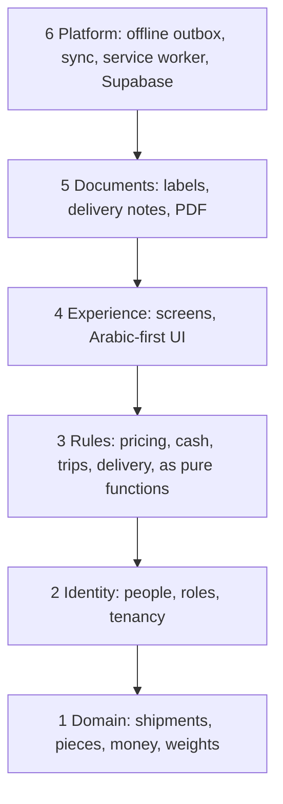

# Rihla: engineering case study

Rihla is software for small freight carriers that move diaspora baggage between France and Morocco. One round trip lasts about 24 days, carries around 77 shipments and 442 physical bags, and until now was run on paper registers and Excel. Rihla is a single installable web app with three faces: the office desktop, the counter tablet and the driver's phone. It is Arabic-first, French as an equal language, and it has to work with no signal for hours: at the border, on the ferry, on mountain roads.

The source is private. This page is about the hard problems in it, most of which any team building offline-first or multi-tenant software meets sooner or later, and how each one was solved and then pinned down so it can't come back.

**Stack:** React 19, TypeScript (strict), Vite, pnpm workspaces and Turborepo, Dexie (IndexedDB) for the offline copy and outbox, Workbox service worker, Supabase (Postgres, row-level security, auth) in the EU, Zod, i18next with ICU, Vitest, Playwright, StrykerJS, dependency-cruiser, ESLint, lefthook.

**Measured on 16 Nov 2026:** 1,591 unit tests in 93 files across 7 packages, all passing. 21 tables, 52 row-level security policies in 15 migrations. 229 recorded design decisions and 128 logged defects, each with a root-cause class.

---

## Architecture: six layers, imports point down only

Each layer is its own package. Business rules are pure functions with no UI, database or network, so they can be tested exhaustively and reused on the phone, at the counter and on the server. **dependency-cruiser fails the build on any upward import.** A rule is only trusted after a test has watched it bite. That habit caught a real gap: the first config matched `packages/<name>` but missed the `node_modules/@<scope>/<name>` path pnpm actually resolves through, so every layer rule had been passing while catching nothing. The fix now includes a check that plants an illegal import and confirms the build fails.

---

## Hard problem 1: "No error" is not "it worked" (Postgres row-level security)

**The trap.** With row-level security, an `UPDATE` on a row the policy hides doesn't fail. It changes zero rows and returns success. An offline outbox that treats "no error" as "sent" will mark work as delivered when nothing happened.

**Where it bit.** A driver's phone queues a delivery while offline. Meanwhile the office moves that shipment to another truck. When the phone reconnects, the update is filtered out by the policy: zero rows changed, no error, and the event is marked sent. The delivery is lost without a trace.

**The strategy.** Every sender checks the number of rows the server says it changed against the number it meant to change. A mismatch is a failure, the event stays in the queue, and the log names it ("the server changed 0 of 2 rows"). Tests cover each sender against a hidden row, a partly hidden set and a row that moved away.

**What carries over:** with RLS, always ask for the affected-row count, and treat a silent zero as an error.

## Hard problem 2: Two companies, one tablet

**The trap.** Browser storage is per origin, not per user. A shared counter tablet or office PC keeps one IndexedDB for everyone who signs in on it.

**Where it bit.** All local data lived in one database, every screen read whole tables, and startup restored the session without checking whether the data on the device belonged to the same company. On a shared device, one company could see another's shipments.

**The strategy.** One local database per company (`<app>-<companyId>`). The old shared copy is handed over row by row to its rightful owner. "Forget this device" is a real action, and it refuses while the outbox still holds unsent work, saying how many items are waiting. Tenancy is enforced twice: by RLS on the server and by database name on the device.

## Hard problem 3: Offline means opening offline, not just saving offline

Writing locally first was the easy part. The real failure was opening: a driver who closed the tab in a dead zone got a blank screen until he found signal. A Workbox service worker now precaches the app, its CSS and all 59 self-hosted font files. The Arabic fonts are self-hosted because a font CDN breaks offline too, which would bring the same failure back one level down. The outbox syncs per event, not per screen, so a weak connection still drains it. The device is the authority on its own events, and the server orders them by timestamp and never discards a driver's event.

## Hard problem 4: Settings that nothing reads

**The trap.** A setting exists, is documented and appears on the settings screen, but nothing reads it. Nothing errors and no test fails. The owner changes a number and nothing happens.

**The pattern behind it.** It came from functions written with an optional parameter and a default, like `isFlagged(natures, flagged = DEFAULT_LIST)`. The one caller that mattered never passed the company's list, so the company's own setting was quietly overruled. It happened more than once, and the defect ledger groups these as one class (`config-not-read`).

**The strategy.** A rule: **a config value is a required parameter, never optional-with-a-fallback.** The compiler now catches a missing setting at every call site. The ledger also sweeps the source for more instances of any defect class that has appeared twice, so a fix in one place surfaces the same mistake elsewhere.

## Hard problem 5: Tests that pass but wouldn't notice a bug

Coverage says a line ran. It doesn't say a test would notice if that line were wrong. The business-rules layer, where a wrong answer costs a carrier money, is mutation-tested with StrykerJS: it changes the code on purpose (`>` to `>=`, `+` to `-`, a condition to `true`) and checks that some test fails each time. **Run on 16 Nov 2026: 98.58%, 1,734 of 1,759 mutants killed**, and the run fails below 97%. The project's own records show the score rising from 83.99% to 97.07% in one pass of killing survivors worst-first, which added 124 tests. A finding from that pass: under Vitest 4, Stryker's per-test coverage analysis over-reported survivors. Of 43 mutants reported alive, 32 were already killed.

A runnable piece of these rules is public: [tariff-dead-zone](https://github.com/shad-yy/tariff-dead-zone), mutation-tested in public CI.

## Hard problem 6: Arabic-first, right-to-left, with numbers that don't flip

- **Design in Arabic first.** Arabic needs roughly twice the vertical space of French. Screens laid out in French first overflow in Arabic.
- **Logical CSS only** (`ms-`/`me-`, never `ml-`/`mr-`), enforced by an ESLint rule. A single physical property breaks only the Arabic layout, which is the one a French-reading developer never looks at.
- **Latin digits wrapped in Unicode isolates.** Without them, "0 / 5" renders as "5 / 0" in a right-to-left line. Every number goes through one formatter, and a lint rule enforces it.
- **ICU plurals.** Arabic has six plural forms, so `n === 1 ? a : b` is wrong by construction.

## Hard problem 7: Choosing a backend under real constraints

The constraints were EU data residency (identity documents of French residents), hard tenant isolation at the query layer, and "start free, then pay per unit, never a plan jump". Five options were priced from the vendors' own pages. Convex lost on EU residency, despite being the only major backend that meters overage on its free plan. Neon and Appwrite stop or freeze instead of metering. The decision: **Supabase (EU) for structured data, Cloudflare R2 for photos**, because R2 charges nothing for egress and photos are the only thing that grows. Photos are compressed on the client to WebP (1600 px, hard cap 150 KB), so the free tier lasts for years instead of months.

---

## How the work is run

- **Every fix ships with a test that was watched going red.** Break the guard, see the test fail, restore it.
- **A defect ledger with root-cause classes.** 128 entries, each with the surface it touched and the test that pins it. The ledger names the files that have carried more than one defect, because a change there is the most likely to break something else.
- **A nightly run that breaks every guard on purpose** in a throwaway copy, to prove each check still fails when it should.
- **Git hooks** run typecheck, tests, lint, the layer rule and a secret scan on every commit. A secret scan is only useful if it recognises the keys you actually use: it was extended when Supabase's new key format (plain strings rather than JWTs) turned out to be invisible to it, and it now scans the whole git history.
- **229 decisions recorded** with their reasons, plus the options that were rejected, so nothing gets re-proposed by accident.

*I set the architecture, write the specifications, review and test every change, and decide what ships. AI coding agents are the tools I direct for implementation.*
